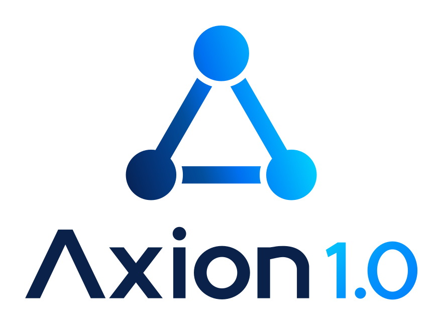
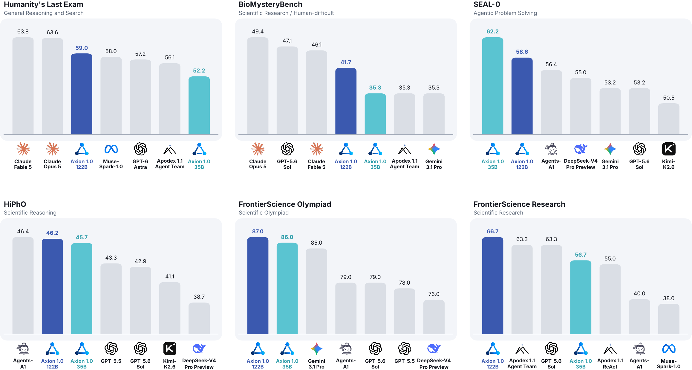
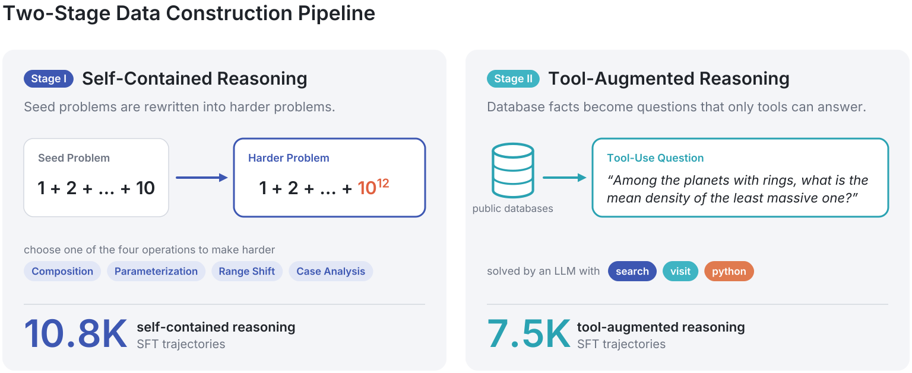
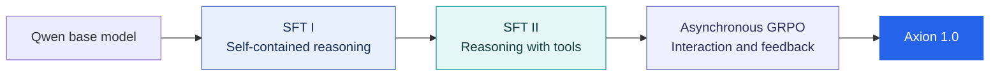

<div align="center">
  <picture>
    <source media="(prefers-color-scheme: dark)" srcset="assets/axion-logo-dark.svg">
    
  </picture>

  <h1>Open Agent Foundation Models, Simplified</h1>

  <p><strong>Strong agents. A simpler recipe.</strong></p>

  <p>
    <a href="https://axion1-0.github.io/"></a>
    <a href="https://axion1-0.github.io/paper/axion.pdf"></a>
    <a href="https://github.com/bytedance/axion1_0"></a>
    <a href="LICENSE"></a>
  </p>

  <p>
    Yuqi Jia<sup>1</sup> · Yunjie Tian<sup>2,†</sup> · Jiayu Zheng<sup>2</sup><br>
    Yijun Liang<sup>3</sup> · Jingchen Sun<sup>4</sup> · Mengyu Zhao<sup>2</sup> · Di Fu<sup>2</sup>
  </p>
  <p>
    <sup>1</sup> Duke University &nbsp; <sup>2</sup> ByteDance<br>
    <sup>3</sup> University of Maryland, College Park &nbsp; <sup>4</sup> University at Buffalo<br>
    <sup>†</sup> Project Lead
  </p>

  <p>
    <a href="#highlights">Highlights</a> ·
    <a href="#benchmark-results">Results</a> ·
    <a href="#the-recipe">The Recipe</a> ·
    <a href="#getting-started">Getting Started</a> ·
    <a href="#citation">Citation</a>
  </p>
</div>

---

**Axion 1.0** is a family of agent foundation models for scientific reasoning,
information seeking, and problem solving with tools. Its training follows a
simple progression: **learn to reason → learn to investigate → learn through
interaction**. Two stages of supervised fine-tuning (SFT), followed by
reinforcement learning (RL), develop these capabilities from Qwen base models.

The central investment is in the data: challenging problems that respond to
the base model's capabilities, and tasks grounded in real data with answers
that can be verified. This repository shares the data construction pipelines,
prompts, training recipes, and evaluation tools behind the work.

| **18,363** | **35B / 122B** | **128K** | **6** |
|:---:|:---:|:---:|:---:|
| SFT trajectories across two stages | Main MoE models | SFT context in the paper | Evaluation settings |

## Highlights

- **A compact training recipe.** Two SFT stages and RL, with no dedicated
  mid-training, DPO, or on-policy distillation stages.
- **Strong scientific reasoning.** Axion 1.0-122B achieves **87.0** on
  FrontierScience Olympiad and **66.7** on FrontierScience Research, alongside
  **59.0** on full HLE under restricted website access.
- **Tools as part of the learning problem.** Agents learn to search the web,
  inspect pages, retrieve scholarly information, and execute Python to acquire
  evidence and compute answers. Axion 1.0-35B scores **62.2** on SEAL-0.
- **Verifiable data at both stages.** Model-aware question strengthening
  develops reasoning; deterministic construction over public data sources
  establishes reference answers for tool use before a solver attempts a task.
- **Methods you can inspect and extend.** Follow the process from question
  generation and trajectory filtering to SFT, asynchronous GRPO, and benchmark
  preparation and grading.

## Benchmark results

<p align="center">
  <a href="assets/benchmark-results.png">
    
  </a>
</p>
<p align="center">
  <em>The project's original comparison figure. Blue: Axion 1.0-122B. Teal: Axion 1.0-35B.</em>
</p>

Selected results from Table 1 of the
[technical report](https://axion1-0.github.io/paper/axion.pdf#page=9):

| Model | HLE | BMB | SEAL-0 | HiPhO | FS Olympiad | FS Research |
|:---|---:|---:|---:|---:|---:|---:|
| Agents-A1 | 47.6 | — | 56.4 | 46.4 | 79.0 | 40.0 |
| Apodex 1.1 (Agent Team) | 56.1 | 35.3 | — | — | — | 63.3 |
| GPT-5.6 Sol | — | 47.1* | 53.2* | 42.9* | 79.0* | 63.3* |
| Gemini 3.1 Pro | 51.4 | 35.3* | 53.2* | 38.5* | 85.0* | 26.7* |
| Claude Fable 5 | 63.8 | 46.1 | — | — | — | — |
| **Axion 1.0-35B** | **52.2** | **35.3** | **62.2** | **45.7** | **86.0** | **56.7** |
| **Axion 1.0-122B** | **59.0** | **41.7** | **58.6** | **46.2** | **87.0** | **66.7** |

*BMB: BioMysteryBench, human-difficult subset. FS: FrontierScience. A dash
denotes an unreported result. An asterisk marks a baseline evaluated by the
Axion team; other baseline scores in this table come from official reports.*

> [!NOTE]
> Axion scores are the best single-run scores from three runs per benchmark,
> or five for BMB. HLE here is the **full benchmark**, with access to websites
> such as Hugging Face blocked. The paper's training-stage comparisons use a
> separate **130-question text-only subset (HLE-130)**. Baseline tool access and
> execution settings may differ; see Section 4.1 and Table 1 of the report.

### Model family

| Model | Base model | Total / active parameters | Training |
|:---|:---|:---:|:---|
| Axion 1.0-35B | Qwen3.6-35B-A3B | 35B / 3B | SFT I → SFT II → RL |
| Axion 1.0-122B | Qwen3.5-122B-A10B | 122B / 10B | SFT I → SFT II → RL |

The paper also studies **4B and 9B variants trained with the two SFT stages**,
without RL, and compares two different 35B initializations. See Section 4.4
for the results and the limits of comparisons across model sizes.

**Release status:** code and recipes are available in this repository. Model
weights and training dataset links are currently marked *Coming soon* on the
[project website](https://axion1-0.github.io/).

## The recipe

**Establish a question and a verifiable answer first. Collect correct solution
trajectories second.** Both data pipelines follow this principle.

<p align="center">
  <a href="assets/data-construction.svg">
    
  </a>
</p>
<p align="center">
  <em>Data construction overview from the project website, corresponding to the two pipelines in Section 2 of the paper.</em>
</p>

### 01 · Learn to reason

Stage I starts from public scientific and mathematical problems. Composition
turns a seed's answer into an essential intermediate step in a new problem.
When the base model solves that problem, its successful solution informs a
further transformation: **composition, parameterization, range shift, or case
analysis**. Reference answers are checked again after each rewrite.

Solvers can use Python but cannot retrieve external information. Only correct,
complete trajectories with valid tool interactions are retained.

**10,819 trajectories** · [Stage I data construction](datagen/stage1/README.md)

### 02 · Learn to investigate

Stage II constructs questions over structured public data through
**filter → select → compute → verbalize**. Deterministic programs identify a
unique target and establish its reference answer. The construction data and
answers are withheld during solving, so agents must recover the evidence
through tools. Questions already solvable without retrieval are filtered out.

The repository includes generators for individual entities, ranked lists, and
chains across databases, using sources such as the NASA Exoplanet Archive,
OurAirports, OpenAlex, UniProt, and Ensembl. Intermediate entities and values
can also serve as verification targets.

**7,544 trajectories · approximately 312M tokens** ·
[Stage II data construction](datagen/stage2/README.md)

### 03 · Learn through interaction

Starting from the Stage II checkpoint, **asynchronous GRPO** trains on the
model's own interactions with search, webpage visits, scholarly retrieval,
and Python. Correct final answers receive full reward; verified intermediate
progress can receive partial credit. Context condensation divides long
rollouts into sessions for training.

[SFT guide](train/sft/README.md) · [RL guide](train/README.md)



## Built to train

The paper's infrastructure supports complete agent trajectories during SFT
and concurrent environment interaction and policy updates during RL:

- **Long-context SFT:** full-parameter training with a 128K context window,
  combining FSDP, expert parallelism, and context parallelism.
- **Asynchronous RL:** separate GPU pools for rollout generation, policy
  optimization, and auxiliary services, with session-level training for long
  trajectories.
- **Consistency between rollout and training:** Token-In-Token-Out (TITO)
  preserves token IDs, while Rollout Routing Replay (R3) aligns MoE expert
  choices between the rollout engine and trainer.

Two-stage SFT costs reported in Section 5.1:

| Model | GPUs | Stage I | Stage II | Total GPU-hours |
|:---|---:|---:|---:|---:|
| Axion 1.0-35B | 32 | 1h 02m | 1h 46m | ≈90 |
| Axion 1.0-122B | 32 | 3h 32m | 3h 58m | 240 |

These measurements describe the paper's **ms-swift / Megatron-FSDP** SFT
implementation. The SFT entry point bundled here uses **LLaMA-Factory with
the Megatron backend** and ships **98,304-token** configurations. Follow the
[SFT guide](train/sft/README.md) for this implementation's parallelism and
sequence-length constraints.

## Getting started

### Install

```bash
git clone https://github.com/bytedance/axion1_0.git
cd axion1_0

conda create -n axion python=3.12
conda activate axion

pip install --index-url https://download.pytorch.org/whl/cu129 \
    torch==2.10.0 torchvision==0.25.0 torchaudio==2.10.0
pip install -r requirements.txt

pip install -e train/verl                 # RL
pip install -e train/sft/LlamaFactory     # SFT
```

`requirements.txt` pins the shared Python environment. GPU training also needs
the CUDA extensions described in the [training guide](train/README.md);
`transformer_engine` must be built against your CUDA and PyTorch installation.
HiPhO grading uses a separate dependency prefix, documented in the
[evaluation guide](eval/README.md).

### Choose your workflow

| Goal | Start here | What is included |
|:---|:---|:---|
| Generate reasoning data | [Stage I](datagen/stage1/README.md) | Seed expansion, model-aware rewrites, answer audits, trajectory filtering |
| Generate data for tool use | [Stage II](datagen/stage2/README.md) | Database generators, paraphrasing, closed-book filtering, scoring, repair and compression |
| Run supervised fine-tuning | [SFT](train/sft/README.md) | Two-stage configs, data validation, checkpoint handoff |
| Train with reinforcement learning | [RL](train/README.md) | 35B/122B recipes, tool services, asynchronous GRPO, cache management |
| Prepare and grade evaluations | [Evaluation](eval/README.md) | FrontierScience Olympiad/Research, HiPhO, HLE-130, and SEAL-0 |

Rollout collection uses an external agent harness; the repository documents
the expected tools and rollout format. Benchmark question sets are prepared
from their sources rather than bundled here. BMB results are reported in the
paper; its evaluation pipeline is not included in this repository.

<details>
<summary><strong>Configure service credentials</strong></summary>

Search, page fetching, and judge models use external services. Supply their
keys through environment variables or a local file you source:

```bash
# ~/.axion_keys
export SERPER_KEY_ID=...        # serper.dev: search and scholarly retrieval
export JINA_API_KEYS=...        # jina.ai: page fetching; comma-separated keys
export OPENAI_API_KEY=...       # generation, verification, or judge endpoint
```

Each data guide specifies its own tool requirements. The
[RL guide](train/README.md) covers sandbox, search, judge, and summarizer
services; the [evaluation guide](eval/README.md) covers grading endpoints.

</details>

## Citation

If you use Axion's models, methods, or code in your research, please cite the
[technical report](https://axion1-0.github.io/paper/axion.pdf):

```bibtex
@techreport{jia2026axion,
  title  = {Axion 1.0: Open Agent Foundation Models, Simplified},
  author = {Jia, Yuqi and Tian, Yunjie and Zheng, Jiayu and Liang, Yijun
            and Sun, Jingchen and Zhao, Mengyu and Fu, Di},
  year   = {2026},
  url    = {https://axion1-0.github.io/paper/axion.pdf}
}
```

## License

This project's own code and associated documentation are released under the
[Apache License, Version 2.0](LICENSE). Vendored third-party components retain
their original licenses and notices; see [THIRD_PARTY.md](THIRD_PARTY.md).
Figure and logo sources are recorded in [assets/README.md](assets/README.md).

<p align="center">
  <a href="https://axion1-0.github.io/">Project Website</a> ·
  <a href="https://axion1-0.github.io/paper/axion.pdf">Technical Report</a> ·
  <a href="#">Back to Top ↑</a>
</p>

